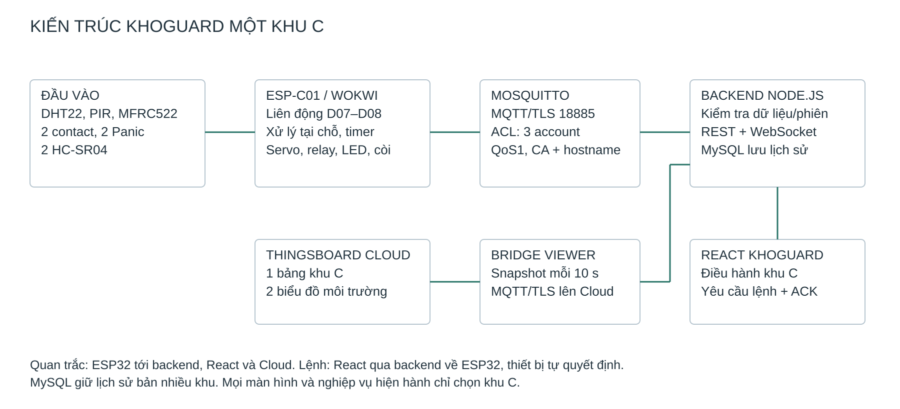

# Kiến trúc KhoGuard một khu

Phạm vi hoạt động: `WH01` / khu `C` / thiết bị `ESP-C01` / cửa `D07`, `D08`. Nguồn chuẩn là `contracts/devices.json`.

## Luồng quan trắc

Firmware đọc input, chạy bộ điều khiển và gửi JSON MQTT/TLS. Mosquitto có 3 account hoạt động: ESP-C01, backend và observer. Backend kiểm tra schema, danh tính, quyền sở hữu cửa, phiên và sequence trước khi lưu MySQL. Snapshot chỉ bao gồm khu C; React lấy qua REST và WebSocket. Bridge đăng nhập viewer để đọc snapshot, chuyển bản sao lên ThingsBoard bằng MQTT/TLS.

## Luồng lệnh

Operator gửi API mở/đóng/reset_panic. Backend chỉ gửi khi ESP có dữ liệu mới và đính kèm boot/session/revision/hạn dùng. ESP kiểm tra input và liên động, trả ACK applied/rejected/expired. Web không tự giả định đã đóng khi publish thành công. ThingsBoard không có widget điều khiển.

## Lưu trữ và phạm vi

Migration SQL 001–007 và seed v1 bất biến. `db/seeds/registry-v1.json` giữ cấu trúc đầu tiên để bảo toàn checksum và khóa ngoại của lịch sử. Không xóa hàng MySQL thuộc A/B/D hoặc SIM-C02. Snapshot, sự kiện, report, access audit và giữ chỗ giới hạn theo registry mới; các API đầu vào từ chối danh tính đã bỏ.

Tiếp nhận chỉ chọn vị trí khu C, hàng frozen. 80 vị trí vật lý, 2 xả đá, 78 khả dụng. Transaction và unique key chống giữ trùng, TTL 15 phút. Không còn quy tắc khu đệm D trong nghiệp vụ hoạt động.

## Mất kết nối

Thiết bị tiếp tục xử lý cục bộ. Backend/bridge không biến unknown/stale/null thành trạng thái an toàn. Snapshot mới của backend vẫn có thể chứa số đo cũ từ thiết bị; Cloud ghi riêng freshness và timestamp. Lịch sử biểu đồ không chứng minh thiết bị đang online.

## Giới hạn

PIR thay tín hiệu chuyển động, HC-SR04 tạo vật cản mô phỏng, servo/relay/LED biểu diễn chấp hành. Mô phỏng không chứng nhận phát hiện người bất động, điện áp, tải nguồn hoặc thoát hiểm phần cứng. Bảng dây và các giả định ở [LINH_KIEN_VA_NOI_DAY.md](docs/LINH_KIEN_VA_NOI_DAY.md).
