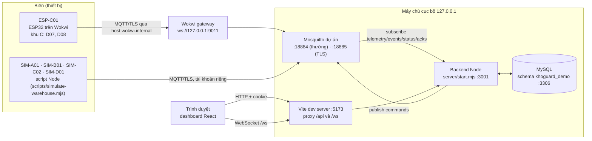
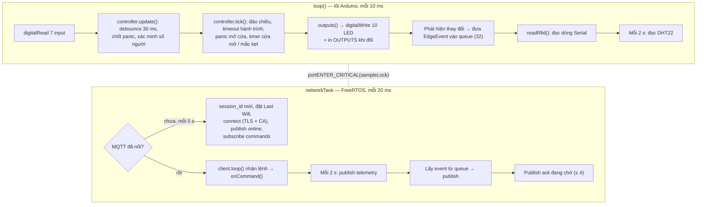
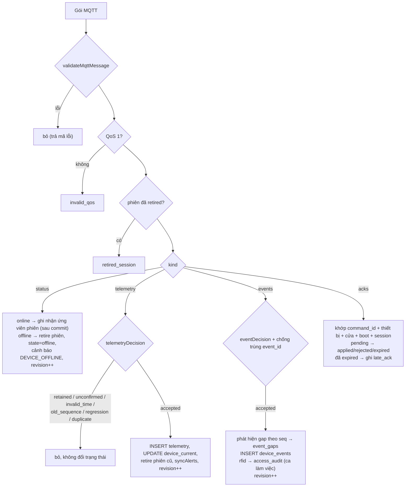
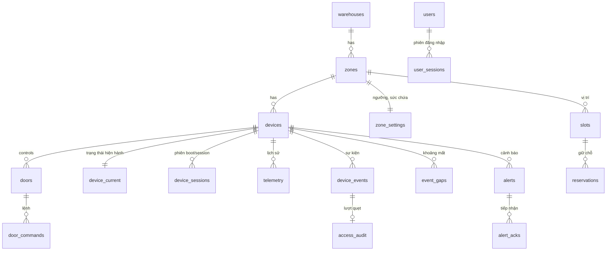
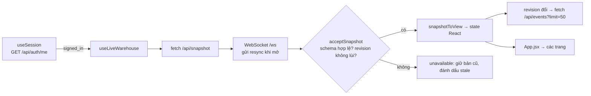
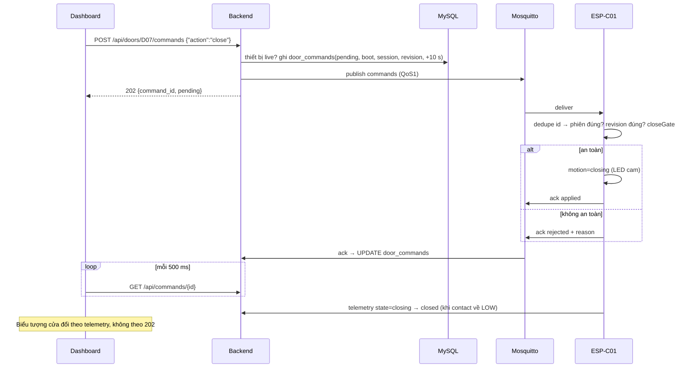

# Kiến trúc KhoGuard

Tài liệu này giải thích **toàn bộ** hệ thống KhoGuard: từng thành phần làm gì, dữ liệu đi qua đâu, vì sao được thiết kế như vậy và cách các quy tắc an toàn được giữ ở mỗi tầng. Người mới chỉ cần biết lập trình cơ bản là đọc được; mọi thuật ngữ IoT đều được giải thích ở [mục 2](#2-thuật-ngữ-cần-biết).

- Cách cài và chạy từng bước: [docs/HUONG_DAN_CAU_HINH.md](docs/HUONG_DAN_CAU_HINH.md)
- Lý do của từng quyết định (DEC-001…DEC-033): [DESITION.md](DESITION.md)
- Kế hoạch, mốc và ma trận kiểm thử: [Agent.md](Agent.md)
- Nhật ký việc đã làm và lỗi đã gặp: [QUA_TRINH.md](QUA_TRINH.md)
- Sơ đồ vẽ sẵn: [docs/architecture/](docs/architecture/README.md)

> **Đây là mô hình mô phỏng.** Không có phần cứng thật. ESP32 chạy trong trình mô phỏng Wokwi; các khu còn lại do script Node giả lập; cảm biến mmWave, RFID, rèm quang là công tắc hoặc dòng lệnh Serial. Hệ thống trình diễn nguyên lý, **không** thay thế Safety PLC, relay an toàn độc lập hay kiểm định thiết bị.

---

## Mục lục

1. [Hệ thống giải quyết bài toán gì](#1-hệ-thống-giải-quyết-bài-toán-gì)
2. [Thuật ngữ cần biết](#2-thuật-ngữ-cần-biết)
3. [Bức tranh tổng thể](#3-bức-tranh-tổng-thể)
4. [Nguyên tắc thiết kế xuyên suốt](#4-nguyên-tắc-thiết-kế-xuyên-suốt)
5. [Cấu trúc thư mục](#5-cấu-trúc-thư-mục)
6. [Registry thiết bị — nguồn sự thật về kho](#6-registry-thiết-bị--nguồn-sự-thật-về-kho)
7. [Hợp đồng dữ liệu (contracts)](#7-hợp-đồng-dữ-liệu-contracts)
8. [Firmware ESP-C01 (edge)](#8-firmware-esp-c01-edge)
9. [Broker MQTT Mosquitto](#9-broker-mqtt-mosquitto)
10. [Backend Node.js](#10-backend-nodejs)
11. [Cơ sở dữ liệu MySQL](#11-cơ-sở-dữ-liệu-mysql)
12. [Dashboard React](#12-dashboard-react)
13. [Các luồng đầu-cuối](#13-các-luồng-đầu-cuối)
14. [Quy tắc nghiệp vụ và an toàn](#14-quy-tắc-nghiệp-vụ-và-an-toàn)
15. [Bảo mật theo lớp](#15-bảo-mật-theo-lớp)
16. [Lỗi, mất kết nối và phục hồi](#16-lỗi-mất-kết-nối-và-phục-hồi)
17. [Kiểm thử](#17-kiểm-thử)
18. [Script và công cụ](#18-script-và-công-cụ)
19. [Giới hạn đã biết](#19-giới-hạn-đã-biết)
20. [Cách mở rộng hệ thống](#20-cách-mở-rộng-hệ-thống)

---

## 1. Hệ thống giải quyết bài toán gì

KhoGuard giám sát một **kho hàng có kho lạnh** gồm 4 khu và 12 cửa:

| Khu | Tên | Nhiệt độ cho phép | Cửa | Thiết bị phụ trách |
| --- | --- | --- | --- | --- |
| A | Kho thường | 18 → 30 °C | D01, D02, D03 | `SIM-A01` (script Node) |
| B | Kho mát | 2 → 8 °C | D04, D05, D06 | `SIM-B01` (script Node) |
| C | Kho lạnh | −22 → −16 °C | D07, D08 | `ESP-C01` (ESP32 trên **Wokwi**) |
| C | Kho lạnh | — | D09 | `SIM-C02` (script Node, chỉ cửa) |
| D | Khu đệm (staging) | 18 → 28 °C | D10, D11, D12 | `SIM-D01` (script Node) |

Bài toán trọng tâm là **bảo vệ người trong kho lạnh**: không được đóng/khóa cửa khi còn người bên trong, nút khẩn cấp phải mở cửa ngay cả khi mạng hỏng, và mọi thông tin chưa chắc chắn phải được coi là *không an toàn*. Ngoài ra hệ thống còn:

- giám sát nhiệt độ/độ ẩm theo ngưỡng từng khu;
- đếm người bằng thẻ RFID và đối chiếu với cảm biến hiện diện (mmWave);
- cảnh báo cửa mở lâu, người mắc kẹt, mất cảm biến, mất kết nối;
- cho người vận hành gửi lệnh mở/đóng cửa nhưng **thiết bị mới là bên quyết định**;
- giữ chỗ nhận hàng theo sức chứa (ngưỡng 85 % / 95 %);
- lưu lịch sử, báo cáo và xuất CSV;
- phân quyền viewer / operator / admin.

Bốn kịch bản trình diễn cuối cùng (chi tiết ở [Agent.md §11](Agent.md)):

1. **Ra/vào hợp lệ** — quẹt thẻ vào → số người 1 → ra → 0 → mới cho đóng.
2. **RFID báo 0 nhưng còn người** — mmWave còn phát hiện → chặn đóng, cảnh báo sai lệch.
3. **Khẩn cấp** — cửa đang đóng, nhấn panic → nhả khóa, mở cửa, bật còi/đèn/sưởi; vẫn hoạt động khi broker chết.
4. **Kho đầy** — sức chứa chạm 95 % → từ chối nhận hàng, kể cả hai yêu cầu đồng thời.

---

## 2. Thuật ngữ cần biết

| Thuật ngữ | Nghĩa trong KhoGuard |
| --- | --- |
| **Edge / thiết bị biên** | Bộ điều khiển đặt tại cửa (ở đây là ESP32 `ESP-C01`). Nó đọc cảm biến và **tự quyết định** an toàn, không cần hỏi máy chủ. |
| **MQTT** | Giao thức nhắn tin publish/subscribe dành cho IoT. Thiết bị *publish* vào một *topic*, ai *subscribe* topic đó sẽ nhận. |
| **Broker** | Máy chủ trung gian MQTT (ở đây là Mosquitto). Thiết bị và backend không nói chuyện trực tiếp mà qua broker. |
| **QoS 1** | Mức đảm bảo "giao ít nhất một lần": broker giữ và gửi lại tới khi nhận được xác nhận `PUBACK`. Hệ quả: **có thể nhận trùng**, nên phải chống trùng. |
| **Retained message** | Tin broker giữ lại và gửi ngay cho người subscribe sau. Hữu ích cho trạng thái online/offline, nhưng **tin retained có thể đã cũ**. |
| **Last Will (LWT)** | Tin thiết bị đăng ký trước khi kết nối; broker tự phát khi thiết bị rớt mạng. KhoGuard dùng để báo `offline`. |
| **Clean / persistent session** | Phiên MQTT sạch quên mọi đăng ký khi ngắt; phiên bền được broker giữ tin QoS 1 chờ client quay lại. |
| **ACL** | Danh sách quyền: tài khoản nào được đọc/ghi topic nào. Mặc định từ chối. |
| **TLS / CA** | Mã hóa kết nối. CA (Certificate Authority) là chứng chỉ gốc dùng để xác minh broker là thật. KhoGuard tự tạo một CA demo riêng. |
| **boot_id** | Chuỗi ngẫu nhiên thiết bị tạo **mỗi lần khởi động**. Đổi boot_id = thiết bị đã reboot. |
| **session_id** | Chuỗi ngẫu nhiên tạo **mỗi lần kết nối MQTT**. Đổi session_id = thiết bị vừa nối lại. |
| **seq** | Số thứ tự tăng dần trong một boot, dùng chống trùng và phát hiện mất tin. |
| **controller_revision** | Bộ đếm tăng mỗi khi trạng thái bộ điều khiển đổi. Lệnh từ backend phải mang đúng revision mới được chạy. |
| **revision (warehouse)** | Bộ đếm của cả kho trong DB, tăng mỗi khi dữ liệu đổi; dashboard dùng để biết khi nào cần tải lại. |
| **Freshness** | Độ mới của dữ liệu: `fresh` (≤ 10 s, phiên đang sống), `stale` (cũ), `unknown` (chưa từng có). |
| **Debounce** | Lọc rung tín hiệu công tắc: chỉ chấp nhận giá trị mới khi nó ổn định ≥ 30 ms. |
| **Latch (chốt)** | Trạng thái giữ nguyên sau khi kích hoạt. Panic đã chốt thì nhả nút **không** tự hết; cần lệnh đặt lại riêng. |
| **Interlock (liên động)** | Hai cửa khu C không được cùng mở trong chế độ bình thường (giữ lạnh). Panic được phép vượt liên động. |
| **Beam / rèm quang** | Cảm biến tia sáng ngang cửa; bị chắn = có vật/người ở cửa → không được đóng. |
| **mmWave / presence** | Cảm biến radar phát hiện người còn trong phòng (ở đây là công tắc mô phỏng). |
| **Close gate (cổng đóng)** | Hàm kiểm tra mọi điều kiện trước khi cho phép đóng cửa. |
| **Gap** | Khoảng `seq` bị thiếu, nghĩa là có event không tới backend; hệ thống ghi lại để không giả vờ dữ liệu đầy đủ. |
| **Snapshot** | Ảnh chụp toàn bộ trạng thái kho mà backend gửi cho dashboard. |
| **FakeEdge** | ESP-C01 giả lập bằng Node, chỉ dùng khi không chạy Wokwi (test tự động). |
| **Wokwi** | Trình mô phỏng vi điều khiển chạy trong VS Code; chạy đúng file `.bin` build từ PlatformIO. |
| **Gateway Wokwi** | Chương trình `wokwigw` cho ESP32 ảo truy cập mạng máy thật qua tên `host.wokwi.internal`. |
| **RFC2217** | Giao thức đưa cổng Serial qua TCP; dùng để script gửi lượt quẹt thẻ vào ESP32 ảo. |

---

## 3. Bức tranh tổng thể

### 3.1 Sơ đồ khối



### 3.2 Ai làm gì (tóm tắt một câu)

| Thành phần | Vai trò | Không làm |
| --- | --- | --- |
| **ESP-C01 (firmware)** | Đọc 7 input + DHT22, debounce, đếm người RFID, quyết định đóng/mở, chốt panic, tính timer, bật output, gửi telemetry/event/ack | Không tin lệnh mù quáng; không cần backend để an toàn |
| **SIM-\*** | Gửi dữ liệu giả lập cho các khu khác theo seed cố định | Không có bộ điều khiển; không nhận lệnh |
| **Mosquitto** | Chuyển tin, kiểm tra tài khoản/ACL, giữ tin cho phiên bền, phát Last Will | Không hiểu nội dung tin |
| **Backend** | Kiểm tra hợp đồng, chống trùng, lưu MySQL, tính freshness, mở/đóng cảnh báo, gửi lệnh có hạn, API + WebSocket, đăng nhập, giữ chỗ, báo cáo | Không tự quyết định an toàn cửa; không bịa dữ liệu khi lỗi |
| **MySQL** | Lưu trữ bền, ràng buộc khóa ngoại/unique chống trùng | — |
| **Dashboard** | Hiển thị, gửi yêu cầu, hiển thị lý do từ chối | Không tự đổi trạng thái cửa; không tự rơi về số giả khi mất backend |

### 3.3 Cổng mạng

| Cổng | Dịch vụ | Bind | Ghi chú |
| --- | --- | --- | --- |
| 18884 | Mosquitto (không mã hóa) | 127.0.0.1 | Chỉ dùng trên localhost |
| 18885 | Mosquitto TLS ≥ 1.2 | 127.0.0.1 | Backend, SIM-\*, ESP-C01 dùng cổng này sau `infra:tls:setup` |
| 3306 | MySQL | máy | Dịch vụ có sẵn; dự án chỉ dùng schema riêng |
| 3001 | Backend HTTP + WebSocket | 127.0.0.1 | Cố định loopback trong code |
| 5173 | Vite (dashboard dev) | 127.0.0.1 | Proxy `/api`, `/ws` → 3001 |
| 9011 | Wokwi gateway | 127.0.0.1 | ESP32 ảo ra mạng |
| 9080 | Wokwi gateway port-forward | mọi interface (do upstream) | Firmware không có HTTP server |
| 4000 | Serial RFC2217 của Wokwi | 127.0.0.1 | Chỉ khi simulator chạy; dùng cho `wokwi:acceptance` |

---

## 4. Nguyên tắc thiết kế xuyên suốt

Các nguyên tắc dưới đây giải thích phần lớn những đoạn code "có vẻ thừa" trong dự án.

1. **Unknown không bao giờ là an toàn.** Cảm biến chưa đọc, số người chưa xác minh, dữ liệu cũ → đều chặn đóng cửa. Không dùng `0` thay cho `null`: nhiệt độ mất là `null`, không phải 0 °C; số người chưa xác minh là `null`, không phải 0.
2. **An toàn quyết định tại edge.** ESP-C01 tự kiểm tra cổng đóng, tự chốt panic, tự chạy timer. Backend và dashboard chỉ *yêu cầu* và *hiển thị*. Mất broker/backend không làm mất bảo vệ (DEC-006).
3. **Contract trước, tích hợp sau.** Mọi tin MQTT và snapshot phải khớp JSON Schema trong `contracts/` (DEC-004). Một validator dùng chung cho backend, script và test.
4. **Một nguồn sự thật cho mỗi dữ liệu.** `contracts/devices.json` quyết định thiết bị nào thuộc khu nào, cửa nào; không tin `zone_id` do thiết bị tự khai (DEC-005).
5. **Lệnh là yêu cầu có hạn dùng.** Lệnh gắn với đúng `boot_id` + `session_id` + `controller_revision`, có TTL; HTTP 202 không có nghĩa cửa đã mở. Cửa trên UI chỉ đổi theo telemetry (DEC-020).
6. **Không giả vờ thành công.** DB lỗi → API 503, không trả dữ liệu cũ như thể mới; event mất → ghi *gap*; MQTT chỉ được xác nhận (PUBACK) **sau khi** MySQL commit.
7. **Môi trường riêng, không đụng dịch vụ có sẵn.** Broker riêng (cổng 18884/18885, không phải 1883), schema riêng, tài khoản riêng; script không bao giờ dừng tiến trình không phải của dự án (DEC-007).
8. **Secret không vào Git, không vào trình duyệt.** Mọi mật khẩu/khóa nằm trong `.local/` (bị `.gitignore` và Vite chặn); biến `VITE_*` không chứa secret (DEC-009).
9. **Tách quy tắc thuần khỏi I/O.** `controller.h`, `server/telemetry.mjs`, `alerts.mjs`, `admission.mjs`… là hàm thuần dễ test; phần I/O (GPIO, MQTT, SQL) mỏng và gọi vào chúng.
10. **Mọi thứ đều có giới hạn.** Kích thước body, số dòng trả về, số client WebSocket, hàng đợi event, cửa sổ thời gian truy vấn — để lỗi hoặc tấn công không làm cạn tài nguyên.

---

## 5. Cấu trúc thư mục

```text
khoguard-iot/
├── README.md                 Giới thiệu, chạy nhanh, lệnh
├── ARCHITECTURE.md           (tài liệu này)
├── Agent.md                  Kế hoạch M00–M17, quy tắc, ma trận T01–T27
├── DESITION.md               Quyết định DEC-001…DEC-033 và lý do
├── QUA_TRINH.md              Nhật ký thực hiện, lỗi đã gặp
├── DESIGN.md, PRODUCT.md     Định hướng giao diện/sản phẩm
├── package.json              Script npm (mọi lệnh vận hành) và dependency
├── vite.config.js            Proxy /api,/ws → 3001; chặn phục vụ file secret
├── index.html, public/       Vỏ HTML của dashboard
├── .env.example              Danh sách biến môi trường backend (không có giá trị)
├── .npmrc                    ignore-scripts=true: không chạy script lạ khi cài
│
├── contracts/                HỢP ĐỒNG DỮ LIỆU (dùng chung mọi tầng)
│   ├── devices.json          Registry: kho, khu, thiết bị, cửa
│   ├── mqtt.schema.json      JSON Schema cho envelope + 5 loại payload
│   ├── snapshot.schema.json  JSON Schema cho /api/snapshot
│   ├── validate.js           Ajv + kiểm tra ngữ nghĩa (đúng khu, đúng cửa…)
│   ├── examples.json         Ví dụ hợp lệ/không hợp lệ cho test
│   └── snapshot.example.json
│
├── firmware/                 ESP32 (PlatformIO + Wokwi)
│   ├── platformio.ini        Board esp32dev, thư viện khóa phiên bản, build ra .local/
│   ├── include/controller.h  TOÀN BỘ quy tắc edge (thuần C++, test được trên PC)
│   ├── src/main.cpp          Chỉ gọi thư viện: setup() khởi tạo, loop() chạy 3 bước
│   ├── lib/khoguard/src/     Adapter chia module (xem §8.4): GPIO, DHT22, Serial, WiFi, MQTT/TLS
│   ├── test/controller_test.cpp  Test debounce, RFID, số người (M07–M08)
│   ├── test/safety_test.cpp      Test cổng đóng, panic, liên động, timer, lệnh (M09–M11)
│   ├── diagram.json          Mạch Wokwi: ESP32, DHT22, 7 công tắc, 10 LED
│   └── wokwi.toml            Firmware, gateway 9011, Serial RFC2217 :4000
│
├── server/                   BACKEND
│   ├── start.mjs             Điểm vào: ghép mọi module, khởi động, tắt êm
│   ├── config.mjs            Đọc & kiểm tra biến môi trường (fail sớm)
│   ├── database.mjs          Pool MySQL, kiểm tra quyền sở hữu + checksum migration
│   ├── mqtt.mjs              Client MQTT, TLS, subscribe, backpressure
│   ├── telemetry-store.mjs   Ingest 4 loại tin, snapshot, history, events, lệnh, ack cảnh báo
│   ├── telemetry.mjs         Hàm thuần: quyết định nhận telemetry, query lịch sử, dựng snapshot
│   ├── events.mjs            Hàm thuần: quyết định nhận event, phát hiện gap, query
│   ├── alerts.mjs            Hàm thuần: cảnh báo mong muốn + kế hoạch raise/update/reopen/resolve
│   ├── commands.mjs          Hàm thuần: parse yêu cầu, dựng lệnh MQTT, vòng đời ack
│   ├── auth.mjs              scrypt, cookie, quyền theo vai trò, ca làm việc, khóa đăng nhập
│   ├── access-store.mjs      Đăng nhập/đăng xuất/phiên, audit
│   ├── admission.mjs         Hàm thuần: ngưỡng 85/95 %, khu đệm, chọn slot
│   ├── reservation-store.mjs Transaction giữ chỗ/xác nhận/hủy/hết hạn
│   ├── reports.mjs           5 loại báo cáo có lọc + phân trang
│   ├── http.mjs              Bảng route, kiểm tra Host/Origin/body/quyền
│   └── websocket.mjs         /ws: đẩy snapshot mỗi giây, cần phiên đăng nhập
│
├── db/
│   ├── bootstrap.sql         Tạo schema + 2 tài khoản (chạy bằng admin, 1 lần)
│   ├── migrate.mjs           Bộ chạy migration có journal/checksum/khóa
│   ├── migrations/001…006    SQL theo thứ tự (inventory → giữ chỗ)
│   ├── rollback/001…006      SQL gỡ thủ công (chỉ sau khi backup)
│   └── seeds/inventory.json  Tên kho/khu
│
├── src/                      DASHBOARD React
│   ├── main.jsx, App.jsx     Vỏ ứng dụng, điều hướng, chế độ Demo / Backend
│   ├── useSession.js         Đăng nhập (cookie HttpOnly) qua /api/auth/*
│   ├── useLiveWarehouse.js   Snapshot REST + WebSocket, reconnect, heartbeat
│   ├── live-data.js          Chuyển snapshot → dữ liệu hiển thị; văn bản lý do
│   ├── WarehouseMap.jsx      Sơ đồ 4 khu, chi tiết khu
│   ├── DataTables.jsx        Bảng cửa, môi trường, nhật ký
│   ├── DoorControls.jsx      Gửi lệnh D07/D08, theo dõi kết quả
│   ├── Receiving.jsx         Nhận hàng / giữ chỗ
│   ├── History.jsx, reports.js  Lịch sử, lọc, xuất CSV
│   ├── AccessPanels.jsx      Màn hình đăng nhập, nhật ký ra vào theo ca
│   ├── csv.js                CSV UTF-8 BOM, chặn công thức Excel
│   ├── demo.js               Dữ liệu mẫu cho chế độ "Demo giao diện"
│   └── styles.css, Icon.jsx
│
├── scripts/                  VẬN HÀNH, MÔ PHỎNG, KIỂM TRA (xem mục 18)
├── infra/mosquitto/          Mẫu cấu hình broker (placeholder, không secret)
├── tests/                    Unit test node:test (102 test)
└── docs/
    ├── HUONG_DAN_CAU_HINH.md Hướng dẫn cài đặt từ đầu
    ├── architecture/         Sơ đồ HTML/PNG
    └── evidence/             Bằng chứng kiểm thử từng mốc (M01…M16)

.local/   (KHÔNG vào Git) mật khẩu, CA/khóa TLS, cấu hình broker sinh ra,
          runtime.env, build firmware, log kiểm tra, gateway Wokwi
```

---

## 6. Registry thiết bị — nguồn sự thật về kho

File [contracts/devices.json](contracts/devices.json) mô tả kho:

```json
{ "id": "ESP-C01", "zone_id": "C", "source": "wokwi", "doors": ["D07","D08"], "environment": true, "occupancy": true }
```

| Trường | Ý nghĩa |
| --- | --- |
| `id` | Định danh thiết bị, đồng thời là **tên tài khoản MQTT** và một phần topic |
| `zone_id` | Khu thiết bị thuộc về; tin báo khu khác bị từ chối (`ZONE_MISMATCH`) |
| `source` | `wokwi` (ESP32 thật trong simulator) hoặc `node-simulator`; hiển thị trên UI để không nhầm nguồn |
| `doors` | Cửa thiết bị được phép báo; báo cửa khác bị từ chối (`DOOR_NOT_ASSIGNED`) |
| `environment` | Thiết bị có phải chủ của số đo nhiệt/ẩm khu không |
| `occupancy` | Thiết bị có phải chủ của số người/hiện diện khu không |

Registry được dùng ở **mọi nơi**:

- `contracts/validate.js` — kiểm tra tin MQTT có đúng quyền thiết bị.
- `scripts/local-config.mjs` — sinh ACL Mosquitto (mỗi thiết bị chỉ ghi topic của mình).
- `db/migrate.mjs` — seed bảng `devices`, `doors`; checksum registry được lưu để phát hiện thay đổi ngầm.
- `server/telemetry.mjs` — dựng snapshot đủ 4 khu, 12 cửa, 5 thiết bị kể cả khi chưa có dữ liệu.
- `server/commands.mjs` — chỉ cửa thuộc thiết bị `wokwi` mới nhận lệnh (`NOT_COMMANDABLE`).
- Dashboard — gắn nhãn nguồn "Wokwi" / "Node mô phỏng".

---

## 7. Hợp đồng dữ liệu (contracts)

### 7.1 Topic MQTT

```text
khoguard/v1/WH01/devices/{device_id}/{kind}
```

| kind | Chiều | Nội dung | QoS / retain |
| --- | --- | --- | --- |
| `telemetry` | thiết bị → backend | Ảnh chụp cảm biến + trạng thái bộ điều khiển, mỗi 2 s | QoS 1; ESP-C01 đặt retain nhưng backend **bỏ qua** bản retained khi đăng ký lại |
| `events` | thiết bị → backend | RFID, panic, đổi trạng thái cửa, đảo chiều/lỗi hành trình | QoS 1, không retain, có `event_id` chống trùng |
| `status` | thiết bị → backend | `online` / `offline` (Last Will) | QoS 1, retain |
| `commands` | backend → thiết bị | Lệnh `open` / `close` / `reset_panic` | QoS 1, không retain |
| `acks` | thiết bị → backend | Kết quả lệnh: `applied` / `rejected` / `expired` + lý do | QoS 1, không retain |

### 7.2 Envelope (phong bì) — chung cho mọi tin

```json
{
  "schema_version": 1,
  "warehouse_id": "WH01",
  "device_id": "ESP-C01",
  "boot_id": "8c9703a3739726d42f41dd2efbd8c47f",
  "session_id": "55833007b11e2b330509eb2975d7121b",
  "seq": 42,
  "kind": "telemetry",
  "clock_synced": false,
  "sent_at": null,
  "uptime_ms": 84012,
  "payload": { "zone_id": "C", "...": "..." }
}
```

- `clock_synced=false` thì `sent_at` **bắt buộc** là `null` (ESP32 không có NTP; không bịa giờ). Backend tự ghi `received_at`.
- Tin `events` bắt buộc có `event_id` (firmware dùng `"<boot_id>:<seq>"`); các loại khác **không được** có.
- Tin `commands` bắt buộc `clock_synced=true` và TTL (`expires_at − sent_at`) trong 1…30 000 ms.

### 7.3 Payload theo loại

**Telemetry** (rút gọn từ ESP-C01):

```json
{
  "zone_id": "C",
  "controller_revision": 17,
  "environment": { "temperature_c": -18.4, "humidity_pct": 55 },
  "occupancy": { "current_occupants": 0, "count_verified": true, "presence": false },
  "doors": [
    { "door_id": "D07", "state": "closed", "beam_clear": true, "panic_latched": false,
      "local_inputs_healthy": true, "locked": true },
    { "door_id": "D08", "state": "open", "beam_clear": true, "panic_latched": false,
      "local_inputs_healthy": true, "locked": false, "open_ms": 31250 }
  ],
  "alarms": [ { "code": "DOOR_OPEN_WARNING", "door_id": "D08" } ],
  "outputs": { "light": true, "buzzer": false, "heater": false, "fan": true }
}
```

- `state` ∈ `open | closed | opening | closing | unknown`.
- `beam_clear`, `panic_latched`, `presence` có thể là `null` = chưa biết.
- Nếu `count_verified=true` thì `current_occupants` phải là số nguyên; nếu chưa xác minh thì là `null`.
- Telemetry phải chứa **đủ** mọi số đo và mọi cửa thiết bị sở hữu (`INCOMPLETE_TELEMETRY`).

**Event**: `event_type` ∈ `rfid | panic | door | command_rejected`.

| event_type | Trường bắt buộc thêm |
| --- | --- |
| `rfid` | `card_id`, `direction` (`in`/`out`), `result` (`accepted`/`duplicate`/`unauthorized`) |
| `panic` | `input` (`panic_high`) |
| `door` | `state`; tùy chọn `reason` (vd. `BEAM_BLOCKED` khi đảo chiều, `LOCAL_INPUT_FAILURE` khi quá giờ hành trình) |
| `command_rejected` | `command_id`, `reason` |

**Status**: `{ "zone_id": "C", "state": "online" | "offline" }`.

**Command**: `{ zone_id, door_id, command_id, action, expires_at, expected_revision }`.

**Ack**: `{ zone_id, door_id, command_id, status, reason }` với `status` ∈ `applied | rejected | expired`.

**Reason code** (dùng chung firmware ↔ schema ↔ UI): `OCCUPIED`, `PRESENCE_DETECTED`, `BEAM_BLOCKED`, `PANIC_ACTIVE`, `INPUT_UNKNOWN`, `INTERLOCK_ACTIVE`, `STALE_DATA`, `REVISION_MISMATCH`, `COMMAND_EXPIRED`, `NOT_AUTHORIZED`, `LOCAL_INPUT_FAILURE`. Văn bản tiếng Việt cho từng mã ở `REASONS` trong [src/live-data.js](src/live-data.js).

### 7.4 Validator — `validateMqttMessage(topic, raw)`

[contracts/validate.js](contracts/validate.js) kiểm tra theo thứ tự, dừng ở lỗi đầu tiên:

1. Topic đúng mẫu → không thì `INVALID_TOPIC`.
2. Payload ≤ 65 536 byte → `PAYLOAD_TOO_LARGE`.
3. UTF-8 + JSON hợp lệ → `INVALID_JSON`.
4. Khớp JSON Schema (Ajv strict) → `INVALID_SCHEMA`.
5. `device_id`/`kind` trong envelope trùng với topic → `DEVICE_MISMATCH` (chặn thiết bị giả danh).
6. Thiết bị có trong registry → `DEVICE_NOT_REGISTERED`.
7. `zone_id` đúng khu của thiết bị → `ZONE_MISMATCH`.
8. Cửa (và cửa trong alarm) thuộc thiết bị, không trùng → `DOOR_NOT_ASSIGNED`.
9. Thiết bị là chủ của số đo nó gửi → `UNSUPPORTED_TELEMETRY`.
10. Telemetry đủ mọi số đo/cửa → `INCOMPLETE_TELEMETRY`.
11. Lệnh có TTL hợp lệ → `INVALID_COMMAND`.

`validateSnapshot(value)` kiểm tra snapshot có đủ toàn kho, ID không trùng, sức chứa hợp lệ, `fresh` chỉ khi thiết bị online và tuổi ≤ 10 s. Backend kiểm trước khi gửi; dashboard kiểm lại khi nhận.

### 7.5 Snapshot (`GET /api/snapshot` và WebSocket)

```text
{ schema_version, warehouse_id, revision, generated_at,
  connections: { broker, database },
  zones:   [{ id, name, range:[min,max], capacity, occupied, reserved, environment, occupancy }],
  doors:   [{ id, zone, state, beam_clear, panic_latched, local_inputs_healthy, locked, open_seconds, updated_at }],
  devices: [{ id, zone, source, state, freshness, last_seen_at, boot_id, session_id, controller_revision }],
  alerts:  [{ id:"AL-n", zone, door_id, code, title, detail, level, state, acknowledged, raised_at, resolved_at, acknowledged_at }] }
```

Luôn có đủ 4 khu, 12 cửa, 5 thiết bị. Thiếu dữ liệu thì giá trị là `null`/`unknown`, **không** bỏ phần tử.

---

## 8. Firmware ESP-C01 (edge)

### 8.1 Mạch mô phỏng ([firmware/diagram.json](firmware/diagram.json))

| GPIO | Linh kiện Wokwi | Ý nghĩa (mức HIGH) | Chỉ số input |
| --- | --- | --- | --- |
| 16 (RX2) | slide switch `contact07` | Cửa D07 **mở** | 0 |
| 17 (TX2) | slide switch `beam07` | Rèm quang D07 **thông** | 1 |
| 18 | slide switch `panic07` | Nút khẩn cấp D07 **đang nhấn** | 2 |
| 19 | slide switch `contact08` | Cửa D08 **mở** | 3 |
| 21 | slide switch `beam08` | Rèm quang D08 **thông** | 4 |
| 22 | slide switch `panic08` | Nút khẩn cấp D08 **đang nhấn** | 5 |
| 23 | slide switch `presence` | mmWave **có người** | 6 |
| 15 | DHT22 (+ trở kéo 10 kΩ) | Nhiệt độ/độ ẩm | — |

Mỗi công tắc: chân giữa (2) nối GPIO, chân 1 nối GND, chân 3 nối 3V3. GPIO đặt `INPUT_PULLUP`.

| GPIO | LED | Output |
| --- | --- | --- |
| 25 / 26 | xanh lá | Khóa D07 / D08 đang khóa |
| 27 / 14 | xanh dương / cam | Motor D07 mở / đóng |
| 2 / 13 | xanh dương / cam | Motor D08 mở / đóng |
| 32 | trắng | Đèn khẩn cấp |
| 33 | đỏ | Còi |
| 4 | đỏ | Sưởi |
| 5 | cyan | Quạt lạnh |

Wokwi **không có** đầu đọc RC522, nên RFID được mô phỏng bằng dòng Serial (mục 8.5).

### 8.2 Mô hình chạy (2 luồng)



Điểm quan trọng: **vòng an toàn (`loop`) không bao giờ chờ mạng.** QoS 1 chờ `PUBACK` trong `networkTask`; nếu broker chết, `loop` vẫn đọc input, áp output, chốt panic. Hai luồng chia sẻ `controller` qua khóa `sampleLock` (critical section ngắn, chỉ copy dữ liệu).

### 8.3 `controller.h` — từng khối

[firmware/include/controller.h](firmware/include/controller.h) là C++ thuần (không include Arduino), nên chạy được test bằng `g++` trên máy tính.

**`Input` — debounce.** Mỗi input nhớ `candidate` và thời điểm đổi. Giá trị chỉ được nhận khi ổn định ≥ 30 ms. Trước lần ổn định đầu tiên `known=false` → mọi quy tắc coi là *chưa biết*. Phép trừ `uint32_t(now − changedAt)` an toàn khi `millis()` tràn (~49 ngày).

**`Occupancy` — đếm người bằng RFID.**

- Whitelist demo: `DEMO-017`, `DEMO-018` được phép; `DEMO-999` có trong danh sách nhưng bị thu hồi; thẻ khác là lạ.
- Mỗi thẻ nhớ trạng thái *trong/ngoài*. Quẹt `IN` khi đã trong → `duplicate`; quẹt `OUT` khi đang ngoài → `duplicate`. Vì vậy số người **không bao giờ âm** và đọc lặp không cộng thêm.
- Sau khi boot, `verified=false` (count chưa đáng tin, publish `null`). Chỉ xác minh `count=0` khi mmWave **thông** và **không thẻ nào đang ở trong** (`reconcile`). Không mặc định "khởi động lại = 0 người" (DEC-017).
- Dòng Serial bị tràn (có thể đã nuốt một lượt quẹt) → `invalidate()`.
- `countAllowsClose(o, presence)` = đã xác minh ∧ count = 0 ∧ không presence.

**`closeGate(d)` — thứ tự kiểm tra trước khi đóng** (trả lý do đầu tiên gặp):

```text
1. Có panic ở BẤT KỲ cửa nào           → PANIC_ACTIVE
2. Input cửa / presence chưa biết,
   hoặc số người chưa xác minh         → INPUT_UNKNOWN
3. Số người > 0                         → OCCUPIED
4. mmWave còn người                     → PRESENCE_DETECTED
5. Rèm quang bị chắn                    → BEAM_BLOCKED
→ none (cho phép đóng)
```

**`openGate(d)` — mở cửa.** Contact chưa biết → `INPUT_UNKNOWN`. Có panic → luôn cho mở. Bình thường: cửa còn lại phải **đóng và đứng yên**, nếu không → `INTERLOCK_ACTIVE`.

**Mô hình motor (DEC-019).** Không có cơ cấu thật, nên cửa có `motion` ∈ `idle | opening | closing`. Lệnh hợp lệ đặt motion; khi công tắc contact báo đã tới vị trí, motion về `idle`. Quá 10 s chưa tới → dừng, tăng `faults` (event `LOCAL_INPUT_FAILURE`). Trạng thái hiển thị: `opening/closing` khi đang chạy, ngược lại theo contact.

**`tick(now)` — chạy sau mỗi `update`:**

1. Panic ở cửa d mà cửa chưa mở → bắt đầu `opening`.
2. Đang `closing` mà `closeGate` không còn cho phép (beam chắn, có người…) → **đảo chiều** sang `opening`, ghi `reversalReason`.
3. Tới vị trí → `idle`; quá 10 s → `idle` + fault.
4. Timer cửa mở (`openSince`) và timer mắc kẹt (presence liên tục khi **cả hai cửa đóng**).

**Panic.** Input panic lên HIGH (sau debounce) → `panic[d]=true` và **chỉ** hết bằng lệnh `reset_panic` khi nút đã nhả (`PANIC_ACTIVE` nếu còn giữ). Tiếp nhận cảnh báo trên dashboard **không** đặt lại panic. Bất kỳ panic nào cũng **nhả khóa cả hai cửa** để thoát hiểm.

**Khóa.** `locked(d)` = cửa đóng ∧ motor đứng yên ∧ không có panic.

**Timer cảnh báo** (thời gian monotonic `millis()`):

| Alarm | Điều kiện |
| --- | --- |
| `DOOR_OPEN_WARNING` | cửa mở ≥ 30 000 ms |
| `DOOR_OPEN_CRITICAL` | cửa mở > 60 000 ms |
| `TRAPPED_PERSON` | presence liên tục khi cả hai cửa đóng > 300 000 ms |

**Output** (mô hình giả định, DEC-021): `emergency` = có panic ∨ mắc kẹt.

| Output | Bật khi |
| --- | --- |
| Đèn | emergency ∨ cảnh báo cửa mở ≥ 30 s |
| Còi | emergency ∨ cửa mở > 60 s |
| Sưởi | emergency (giữ ấm người kẹt trong kho lạnh) |
| Quạt lạnh | **không** emergency (tắt quạt khi có người gặp nạn) |
| Khóa / motor | theo `locked()` và `motion` |

**`command(in, now)` — xử lý lệnh từ backend:**

1. `command_id` đã gặp trong 8 lệnh gần nhất → trả lại **đúng kết quả cũ**, không chạy lại (QoS 1 có thể giao trùng).
2. Lệnh không gửi cho đúng `boot_id`+`session_id` hiện tại → `COMMAND_EXPIRED` (lệnh của phiên cũ không bao giờ chạy sau reconnect).
3. `expected_revision` ≠ `revision` hiện tại → `REVISION_MISMATCH` (người vận hành đang nhìn trạng thái cũ).
4. Ngược lại → `request()` qua `openGate`/`closeGate`/reset panic.

### 8.4 `lib/khoguard` — adapter phần cứng và mạng

`src/main.cpp` không còn logic, chỉ gọi thư viện riêng `firmware/lib/khoguard/src` (PlatformIO tự biên dịch thư mục `lib/`; `platformio.ini` thêm `-Iinclude` để thư viện thấy `controller.h`):

```cpp
void setup() { Serial.begin(115200); kg::state::begin(); kg::environment::begin(); kg::board::begin();
               if (!kg::events::begin()) return; kg::network::start(); }
void loop()  { kg::edge::step(); kg::rfid::poll(); kg::environment::poll(); delay(10); }
```

| Module | Vai trò |
| --- | --- |
| `kg_state` | Trạng thái dùng chung giữa `loop` và task mạng: `Controller`, `sampleLock`, `bootId`/`sessionId`, mẫu DHT |
| `kg_board` | Bảng chân `INPUT_PINS`/`OUTPUT_PINS`/`DHT_PIN`, đọc 7 input, ghi 10 LED + log `OUTPUTS` |
| `kg_environment` | DHT22: đọc mỗi 2 s, `SENSOR_HEARTBEAT` |
| `kg_events` | Queue 32 event, `enqueue` (đánh `seq`, `EVENT_GAP`), so trạng thái trước/sau để sinh `INPUT_EVENT`/`SAFETY_EVENT` |
| `kg_edge` | Một nhịp an toàn: đọc input → `update`/`tick` trong khóa → ghi output → báo event |
| `kg_rfid` | Đọc dòng Serial không chặn, `parseRfid`, `scan`, `RFID_EVENT` |
| `kg_commands` | Callback MQTT `commands`: kiểm tra, gọi `controller.command`, xếp ≤ 4 ack |
| `kg_messages` | Topic + dựng JSON: envelope, telemetry, event, ack |
| `kg_network` | WiFi, banner, `networkTask` (kết nối, Last Will, publish QoS1) |
| `khoguard.h` | Header gom các module mà `main.cpp` gọi |

- **Khởi động**: tạo `boot_id` ngẫu nhiên, `pinMode`, tạo queue 32 event, nối WiFi `Wokwi-GUEST`, in banner `KHOGUARD_M12 boot=… transport=mqtts:18885 CA-verified`, tạo `networkTask` (stack 12 KB khi có TLS).
- **Kết nối MQTT**: host `host.wokwi.internal`, cổng 18885 với `WiFiClientSecure` + CA demo nhúng từ `.local/firmware/kg_secrets.h` (do `firmware:prepare` sinh). **Không bao giờ** `setInsecure()`. Mỗi lần nối: `session_id` mới, Last Will `offline` (retain), clean session (lệnh cũ không giao lại), publish `online`, subscribe `commands`.
- **Telemetry** mỗi 2 s: nhiệt/ẩm DHT22 chỉ gửi nếu mẫu ≤ 5 s và trong miền hợp lệ, nếu không là `null`; số người chỉ gửi khi đã xác minh.
- **Event**: lấy từ queue; envelope (kể cả `session_id`) được tạo **lúc gửi**, nên event xếp hàng khi mất mạng vẫn đi với phiên mới hợp lệ. Queue đầy → in `EVENT_GAP` (backend sẽ thấy gap theo `seq`).
- **onCommand**: chạy trong callback MQTT, chỉ xếp ack (≤ 4) — publish ack ở vòng lặp mạng, không bao giờ trong callback.
- **JSON** ≤ 4096 byte; vượt thì không gửi (`JSON_LIMIT`).

### 8.5 Giao thức Serial

| Chiều | Dòng | Ý nghĩa |
| --- | --- | --- |
| vào | `RFID D07 DEMO-017 IN` | Quẹt thẻ: cửa `D07`/`D08`, mã thẻ, `IN`/`OUT` (không phân biệt hoa thường) |
| ra | `RFID_EVENT door=D07 card=DEMO-017 dir=in result=0 count=1 verified=1` | `result`: 0 accepted, 1 duplicate, 2 unauthorized |
| ra | `RFID_FORMAT: …` | Dòng sai cú pháp, không tạo event |
| ra | `RFID_LINE_DROPPED: …` | Dòng > 63 ký tự; số người bị coi chưa xác minh |
| ra | `INPUT_EVENT door=D07 panic=1 open=0 revision=…` | Đổi contact hoặc panic mới chốt |
| ra | `SAFETY_EVENT door=D07 closing reversed BEAM_BLOCKED` | Đảo chiều / timeout hành trình |
| ra | `OUTPUTS ms=… lock=00 motor07=10 motor08=00 light=1 buzzer=1 heater=1 fan=0` | Mức 10 output mỗi khi đổi (bằng chứng khi mất broker) |
| ra | `COMMAND cmd-… D07 close -> OCCUPIED` | Kết quả lệnh |
| ra | `MQTT_ONLINE`, `MQTT_RETRY`, `TELEMETRY_ACK`, `SENSOR_HEARTBEAT` | Trạng thái mạng và cảm biến |

Serial được mở ra TCP `127.0.0.1:4000` (RFC2217, cấu hình trong `wokwi.toml`) để script gửi lệnh.

---

## 9. Broker MQTT Mosquitto

Cấu hình sinh từ [infra/mosquitto/mosquitto.conf.example](infra/mosquitto/mosquitto.conf.example) bởi `infra:setup` (+ `infra:tls:setup`):

- Listener `127.0.0.1:18884` và `127.0.0.1:18885` (TLS, cert có SAN `localhost`, `host.wokwi.internal`, `127.0.0.1`).
- `allow_anonymous false`, file mật khẩu hash, ACL mặc định từ chối.
- `persistence true`; `max_queued_messages 1000`, `persistent_client_expiration 1d` — giới hạn tin giữ cho backend khi nó tắt.
- `message_size_limit 65536`.

**Tài khoản và quyền** (sinh từ registry bởi `buildAcl()`):

| Tài khoản | Được đọc | Được ghi |
| --- | --- | --- |
| `khoguard-backend` | `+/telemetry`, `+/events`, `+/status`, `+/acks` | `+/commands` |
| `khoguard-observer` | 4 topic trên + `+/commands` | — (chỉ quan sát, dùng cho kiểm tra) |
| `SIM-A01`, `ESP-C01`, … | `<chính nó>/commands` | `<chính nó>/telemetry`, `events`, `status`, `acks` |

Một thiết bị không thể giả danh thiết bị khác: broker chặn publish sai topic, validator chặn envelope lệch topic.

---

## 10. Backend Node.js

### 10.1 Khởi động — `server/start.mjs`

```text
readConfig(env)        → sai/thiếu biến: thoát mã 1, nêu TÊN biến, không in giá trị
loadOwnership()        → .local/mysql-state.json phải "complete"
createDbPool()         → mysql2, 4 kết nối, không xếp hàng chờ
createTelemetryStore() → ingest + truy vấn (publish lệnh qua broker, gán trễ)
connectBroker()        → clientId cố định "khoguard-backend-3001", clean:false (phiên bền)
createAccessStore()    → đăng nhập/phiên
createApp()            → HTTP server với bảng route
attachSnapshots()      → WebSocket /ws
listen(127.0.0.1:3001)
SIGINT/SIGTERM         → đóng WS, HTTP, MQTT, pool; quá 5 s thì thoát cưỡng bức
```

**`config.mjs`** cố định những thứ không được đổi: host chỉ `127.0.0.1`, DB `khoguard_demo`, user runtime `khoguard_runtime`, MQTT user `khoguard-backend`, cổng MQTT chỉ 18884 hoặc 18885 (18885 ⇒ TLS). Mật khẩu phải khớp `SECRET_PATTERN`: 4–128 chữ/số (máy demo đang dùng `1234`, DEC-041); chỉ chữ/số để ghi an toàn vào C++ và SQL.

### 10.2 Readiness — `database.mjs`

`databaseReady()` không chỉ "ping": nó kiểm tra trong một truy vấn rằng `@@server_uuid` và `setup_id` trùng marker sở hữu, checksum **cả 6 migration** đã `complete`, và checksum seed registry. Sai bất kỳ điều gì → backend coi DB **không sẵn sàng** (không ghi vào schema lạ hoặc schema chưa migrate).

- `GET /api/health` → luôn 200 nếu process sống (liveness).
- `GET /api/ready` → 200 chỉ khi DB sẵn sàng **và** MQTT đã nối + đã subscribe đủ (readiness), ngược lại 503.

### 10.3 Client MQTT — `mqtt.mjs`

- TLS: `protocol: 'mqtts'`, CA từ `.local/tls/ca.crt`, `rejectUnauthorized: true`, TLS ≥ 1.2.
- Khi `connect`: đợi DB sẵn sàng rồi subscribe 4 topic QoS 1; broker phải cấp đủ 4 grant QoS 1, nếu không thử lại sau 1 s. Chỉ khi đó `ingestReady=true`.
- **Backpressure**: ghi đè `client.handleMessage` để xử lý **từng gói một**; `done()` (→ PUBACK) chỉ gọi **sau khi** ingest commit xong.
- **Ingest lỗi** (DB rớt…): không PUBACK, hủy kết nối → broker giữ tin trong phiên bền và giao lại khi nối lại. Đây là cách "không mất tin khi DB lỗi" (DEC-025).
- `generation` tăng mỗi lần mất kết nối. Gói còn trong bộ đệm của kết nối cũ **không** được PUBACK (trả `STALE_CONNECTION`): nếu ACK, MQTT.js sẽ gửi PUBACK sau khi nối lại và broker bỏ tin chưa lưu (DEC-036).

### 10.4 Ingest — `telemetry-store.mjs`

Mỗi tin được xử lý trong **một transaction MySQL** (khóa dòng `device_current FOR UPDATE`, lock wait 1 s, deadline 5 s; lỗi → rollback, hủy kết nối, xóa trạng thái phiên trong bộ nhớ).



**Vì sao cần "ứng viên phiên" (candidate)?** Telemetry chỉ được nhận khi phiên `(boot_id, session_id)` đã được xác nhận bằng tin `status: online` của **chính kết nối hiện tại** (hoặc là phiên đang hiện hành trong DB). Điều này chặn tin retained cũ hoặc phiên giả từ quá khứ "sống lại".

**`telemetryDecision`** ([server/telemetry.mjs](server/telemetry.mjs)) theo thứ tự: retained → `retained`; phiên đã retired → `retired_session`; phiên không phải ứng viên và cũng không phải phiên hiện hành trong DB → `unconfirmed`; đồng hồ (nếu có) lệch tương lai hoặc cũ > 10 s → `invalid_time`; cùng boot mà `seq` không tăng → `old_sequence`; `uptime_ms` hoặc `controller_revision` lùi → `regression`; còn lại `accepted` nếu phiên đã xác nhận trong kết nối này, hoặc **`backlog`** nếu chỉ trùng phiên hiện hành trong DB (rồi kiểm trùng `(device, boot, seq)` → `duplicate`). `backlog` xảy ra khi broker giao lại khung tồn đọng sau lỗi DB/khởi động lại: chỉ ghi bảng `telemetry`, không đổi trạng thái hiện hành, cảnh báo hay độ tươi (DEC-035).

**Freshness trong bộ nhớ.** `live` là tập phiên đã có telemetry được commit trên kết nối MQTT hiện tại. Mất MQTT hoặc lỗi DB → xóa `live` → mọi thiết bị thành `stale` cho tới khi telemetry mới tới. Thiết bị là `fresh` khi: có tin, `state=online`, MQTT đang nối, phiên trong `live`, nhận ≤ 10 s trước (và `sent_at` ≤ 10 s nếu có đồng hồ).

### 10.5 Cảnh báo — `alerts.mjs`

Edge giữ timer; backend chỉ **phản ánh** thành bảng `alerts` có vòng đời.

`desiredAlerts(message)` tính danh sách cảnh báo *đáng lẽ đang có* từ một telemetry:

| Mã | Mức | Từ đâu |
| --- | --- | --- |
| `DOOR_OPEN` | warning (≥ 30 s) / danger (> 60 s) | `alarms` của edge |
| `TRAPPED_PERSON` | danger | `alarms` của edge |
| `PANIC_ACTIVE` | danger | `panic_latched=true` |
| `LOCAL_INPUT_FAILURE` | warning | `local_inputs_healthy=false` (chỉ thiết bị Wokwi) |
| `PRESENCE_MISMATCH` | warning | đã xác minh 0 người nhưng presence = true |
| `SENSOR_MISSING` | warning | thiết bị đo môi trường gửi `temperature_c=null` |
| `TEMPERATURE_OUT_OF_RANGE` | warning | ngoài ngưỡng khu; chỉ hết khi vào trong ngưỡng **±0,5 °C** (hysteresis) |
| `DEVICE_OFFLINE_<id>` | warning | Last Will `offline` |

`planAlerts(rows, want, now)` so sánh với dòng mới nhất mỗi khóa `khu|cửa|mã`:

- chưa có → `raise`;
- đang active, mức khác → `update` (tăng mức thì **xóa tiếp nhận**, cần tiếp nhận lại);
- đã resolved < 60 s trước → `reopen` cùng dòng (`occurrences+1`) thay vì tạo dòng mới (chống spam);
- active mà không còn trong `want` → `resolve`.

**Tiếp nhận** (`POST /api/alerts/AL-n/ack`) chỉ ghi `alert_acks` và `acknowledged_at/by`; **không** đổi `state`. Cảnh báo chỉ hết khi điều kiện hết.

### 10.6 Lệnh cửa — `commands.mjs` + `store.command()`

1. `parseCommandRequest`: body đúng `{"action": "open"|"close"|"reset_panic"}`; cửa phải thuộc thiết bị `wokwi` (cửa của SIM → 409 `NOT_COMMANDABLE`).
2. Trong transaction: thiết bị phải online, phiên trong `live`, telemetry ≤ 10 s, có revision → nếu không 409 `DEVICE_NOT_LIVE`.
3. Ghi `door_commands` (pending) với `boot_id`, `session_id`, `expected_revision`, `expires_at = now + 10 s`, `requested_by` = tên tài khoản.
4. Publish QoS 1 lên `…/ESP-C01/commands`. Broker không nhận → cập nhật `rejected / NOT_SENT` (không bao giờ để pending treo).
5. Trả **202** `{command_id, status:"pending"}` — chưa có nghĩa cửa đã chạy.
6. Ack về → `applied` / `rejected` (+lý do) / `expired`.
7. `GET /api/commands/:id`: nếu vẫn pending quá `expires_at + 2 s` → `expired / COMMAND_EXPIRED`. Ack tới sau đó lưu ở `late_ack` để không mất kết quả thật.

Edge không có NTP nên **không** tự so `expires_at`; nó bảo vệ bằng phiên + revision (DEC-020). Mốc 10 s là phía backend.

### 10.7 HTTP — `http.mjs`

Mọi route khai báo trong bảng `ROUTES`: `method`, `path`, `auth`/`permission`, cần `db`/`mqtt` hay không, parser `query`, hàm `run`.

**Kiểm tra cho mọi request** (theo thứ tự):

1. Header `Host` phải là `127.0.0.1:<port>` hoặc `localhost:<port>` → chống DNS rebinding (`400 INVALID_HOST`).
2. URL ≤ 2048, không `//`, không `#`.
3. Route tồn tại (404) và đúng method (405 + `Allow`).
4. Có query mà route không nhận query → 400.
5. **POST**: `Origin` phải là dashboard cục bộ (5173 dev / 4173 preview), **thiếu Origin cũng bị chặn** (403); `Content-Type: application/json` (415); body ≤ 512 byte (413).
6. GET không được có body.
7. Route cần DB mà DB chưa sẵn sàng → 503 `DATA_UNAVAILABLE`.
8. Route không public: cookie phiên hợp lệ (401, kèm xóa cookie) và vai trò có quyền (403 `FORBIDDEN_ROLE`, ghi audit `denied`).
9. Route cần MQTT mà broker mất → 503 `BROKER_UNAVAILABLE`.

Header phản hồi luôn có `cache-control: no-store`, `x-content-type-options: nosniff`, `x-frame-options: DENY`, `content-security-policy: default-src 'none'`. Server: timeout header/request 5 s, socket 10 s, tối đa 100 request/kết nối. Lỗi không lường trước → 503 chung, không lộ chi tiết.

**Bảng API:**

| Method | Đường dẫn | Quyền | Mô tả |
| --- | --- | --- | --- |
| GET | `/api/health` | public | Liveness |
| GET | `/api/ready` | public | Readiness DB + MQTT |
| POST | `/api/auth/login` | public | `{username,password}` → cookie `kg_session` |
| POST | `/api/auth/logout` | public | Thu hồi phiên |
| GET | `/api/auth/me` | read | Người dùng, vai trò, danh sách quyền |
| GET | `/api/auth/audit` | auth_audit | Nhật ký đăng nhập (admin) |
| GET | `/api/access` | access_audit | 50 lượt ra/vào gần nhất theo ca |
| GET | `/api/snapshot` | read | Toàn bộ trạng thái kho |
| GET | `/api/telemetry?device_id&from&to&limit&cursor` | read | Lịch sử telemetry (≤ 7 ngày, ≤ 200 dòng) |
| GET | `/api/events?device_id&type&limit&cursor` | read | Event mới nhất + 20 gap gần nhất |
| POST | `/api/doors/{D07|D08}/commands` | command | Gửi lệnh → 202 |
| GET | `/api/commands/{id}` | read | Trạng thái lệnh |
| POST | `/api/alerts/AL-{n}/ack` | ack_alert | Tiếp nhận cảnh báo (body `{}`) |
| GET | `/api/reports/{events|alerts|commands|reservations}` | read | Báo cáo có lọc |
| GET | `/api/reports/access` | access_audit | Báo cáo ra vào |
| GET | `/api/reservations` | read | Sức chứa + 20 giữ chỗ gần nhất |
| POST | `/api/admissions` | reserve | Yêu cầu nhận hàng → giữ chỗ |
| POST | `/api/reservations/{id}/confirm|cancel` | reserve | Kết thúc giữ chỗ |

Chi tiết tham số và ví dụ: [server/README.md](server/README.md).

### 10.8 Đăng nhập và phân quyền — `auth.mjs`, `access-store.mjs`

- Mật khẩu lưu **scrypt** (N=16384, r=8, p=1, khóa 64 byte, salt 16 byte); so sánh `timingSafeEqual`. Tên không tồn tại vẫn chạy scrypt với hash giả để thời gian phản hồi giống nhau.
- Token phiên 32 byte ngẫu nhiên; DB chỉ lưu **SHA-256** của token; phiên 8 giờ.
- Cookie `kg_session`: `HttpOnly; SameSite=Strict; Path=/; Max-Age=28800`. Chưa có `Secure` vì chỉ chạy `http://127.0.0.1` (phải thêm nếu đưa ra mạng — DEC-026).
- Sai 5 lần → khóa tên đó 60 s (bộ nhớ, tối đa 1000 tên để không bị làm đầy).
- Mọi lần đăng nhập, sai, bị khóa, đăng xuất, bị từ chối quyền → `auth_audit`.

| Quyền | viewer | operator | admin |
| --- | :-: | :-: | :-: |
| `read` | ✓ | ✓ | ✓ |
| `command` (lệnh cửa) | | ✓ | ✓ |
| `ack_alert` | | ✓ | ✓ |
| `reserve` (nhận hàng) | | ✓ | ✓ |
| `access_audit` (nhật ký ra vào) | | ✓ | ✓ |
| `auth_audit` (nhật ký đăng nhập) | | | ✓ |

**Ca làm việc** (`shiftAt`): DAY 06:00–18:00, NIGHT 18:00–06:00 giờ Việt Nam (UTC+7); ca đêm sau 0 giờ vẫn mang ngày bắt đầu ca. `accessDecision` chỉ phục vụ **audit** (`in_shift`, `out_of_shift`, `exit`, `duplicate`, `unknown_card`, `revoked_card`, `edge_rejected`) — **không bao giờ** chặn người ra hoặc đổi quyết định của edge (DEC-028).

### 10.9 WebSocket — `websocket.mjs`

- Chỉ nhận nâng cấp tại `/ws`, `Origin` cục bộ, `Host` đúng, tối đa 20 client, và **cookie phiên hợp lệ** (401 nếu không).
- Mỗi 1 s (và khi client gửi `{"type":"resync"}`, tối đa 1 lần/s): đọc readiness + snapshot, gửi `{type:"snapshot", data}`; DB lỗi → `{type:"unavailable"}`.
- Client gửi bất cứ thứ gì khác → đóng 1008. Client chậm (buffer > 256 KB) → đóng 1013. `maxPayload` 1024 byte.
- Mỗi 5 s kiểm lại phiên của từng client; phiên hết/đăng xuất → đóng mã **4401** (dashboard hiểu là cần đăng nhập lại).

### 10.10 Giữ chỗ nhận hàng — `admission.mjs`, `reservation-store.mjs`

Xem quy tắc ở [mục 14.3](#143-sức-chứa-và-giữ-chỗ). Về kỹ thuật:

- Mọi thao tác chạy trong transaction **khóa dòng kho `WH01` trước**, rồi khóa slot theo thứ tự `id` ổn định → hai yêu cầu đồng thời không thể cùng vượt ngưỡng; deadlock/lock-timeout được thử lại tối đa 3 lần.
- `request_id` là khóa idempotent: gửi lại đúng yêu cầu → trả kết quả cũ; cùng `request_id` nhưng nội dung khác → 409 `REQUEST_ID_REUSED`.
- Cột sinh `active_slot` (= `slot_id` khi `pending`) có **UNIQUE** → DB cũng không cho một slot có hai giữ chỗ đang chờ.
- Hết hạn tính bằng đồng hồ backend, không dùng đồng hồ trình duyệt.

### 10.11 Báo cáo — `reports.mjs`

Năm loại (`events`, `alerts`, `commands`, `reservations`, `access`), lọc `from`/`to` (mặc định 24 giờ, tối đa 31 ngày), `zone` A–D, `type` theo từng loại, `limit` ≤ 500 (mặc định 100), `cursor` theo `id` giảm dần (trang ổn định khi có dữ liệu mới). SQL chỉ ghép từ bảng `SPECS` cố định; giá trị luôn là tham số `?`.

---

## 11. Cơ sở dữ liệu MySQL

### 11.1 Tài khoản và quyền sở hữu

| Tài khoản | Quyền | Dùng bởi |
| --- | --- | --- |
| admin của bạn (vd. root) | Toàn quyền | **Chỉ** `infra:db:init` một lần |
| `khoguard_migrate@localhost` | DDL trên `khoguard_demo` | `npm run db:migrate` |
| `khoguard_runtime@localhost` | SELECT/INSERT/UPDATE/DELETE trên `khoguard_demo` | Backend, script kiểm tra |

Bảng `infra_meta` giữ `setup_id`; `.local/mysql-state.json` giữ `setup_id` + `server_uuid`. Mọi migration và readiness đều so khớp hai nơi này → không bao giờ ghi nhầm vào schema/instance khác.

### 11.2 Bộ chạy migration — `db/migrate.mjs`

- Bảng `schema_migrations(version, checksum, status applying|complete)` là **journal**.
- Đã `complete` mà checksum khác → **dừng** ("thêm migration mới, không sửa SQL đã áp").
- Còn `applying` (lần trước dở dang) → **dừng**, yêu cầu kiểm tra tay; không tự reset (vì DDL MySQL tự commit, không rollback nguyên tử được).
- `GET_LOCK('khoguard_demo:migrations')` chặn hai lần chạy song song.
- Phát hiện bảng trùng tên mà không có journal của dự án → từ chối.
- Seed inventory chỉ tạo khi trống; chạy lại là no-op và giữ tên/Unicode.

### 11.3 Các bảng theo migration



| Migration | Bảng | Điểm đáng chú ý |
| --- | --- | --- |
| **001_inventory** | `warehouses`, `zones`, `devices`, `doors` | FK kép `(device_id, zone_id)` → cửa không thể gán cho thiết bị khu khác |
| **002_telemetry** | `zone_settings` | Ngưỡng nhiệt và sức chứa: A 18–30/100, B 2–8/80, C −22…−16/80, D 18–28/48 |
| | `warehouse_stream` | `revision` của kho (tăng mỗi thay đổi) |
| | `device_sessions` | `(device, boot, session)` + cờ `retired` (tombstone phiên cũ) |
| | `device_current` | Một dòng/thiết bị: phiên, `state`, `seq`, `uptime_ms`, `controller_revision`, tin JSON cuối |
| | `telemetry` | UNIQUE `(device_id, boot_id, seq)` chống trùng; index `(device_id, received_at, id)` cho lịch sử |
| **003_events** | `device_events` | UNIQUE `(device_id, event_id)`; FK tới khu, cửa |
| | `event_gaps` | `from_seq..to_seq` bị thiếu trong một boot |
| **004_control** | `door_commands` | `status` pending/applied/rejected/expired, `reason`, `late_ack`, `requested_by`, `expires_at` |
| | `alerts` | `alert_key`, `level`, `state` active/resolved, `occurrences`, tiếp nhận |
| | `alert_acks` | Ai tiếp nhận, lúc nào, ở trạng thái/mức nào |
| **005_access** | `users`, `user_sessions`, `auth_audit` | Hash scrypt, hash token, audit |
| | `access_cards` | `DEMO-017` (ca ngày), `DEMO-018` (ca đêm), `DEMO-999` (thu hồi) |
| | `access_audit` | Một dòng/lượt quẹt RFID; UNIQUE `event_id` |
| **006_reservations** | `slots` | Seed tối đa 100 vị trí/khu theo sức chứa: lớp nhiệt (B mát, C lạnh, A/D thường), cỡ 1–3, tải 500/1000/1500 kg; D là khu đệm; C-079, C-080 đang `defrost`; một phần đã `occupied` (demo-seed) |
| | `reservations` | UNIQUE `request_id`, UNIQUE cột sinh `active_slot` |

Tất cả thời gian lưu **UTC** (`DATETIME(3)`, pool `timezone: 'Z'`); dashboard hiển thị giờ Việt Nam.

---

## 12. Dashboard React

### 12.1 Hai chế độ

| Chế độ | Dữ liệu | Đăng nhập | Ghi gì vào hệ thống |
| --- | --- | --- | --- |
| **Backend / MQTT** (mặc định) | `/api/snapshot` + WebSocket | Bắt buộc | Lệnh cửa, tiếp nhận, giữ chỗ |
| **Demo giao diện** | `src/demo.js` trong bộ nhớ trình duyệt; 4 kịch bản mẫu | Không | Không gì cả |

Mất backend **không** tự chuyển sang demo; UI báo mất kết nối, giữ giá trị cuối với nhãn *Dữ liệu cũ*.

### 12.2 Luồng dữ liệu trong trình duyệt



- **Heartbeat**: > 5 s không có snapshot → báo *Chưa nhận được cập nhật backend*, đóng socket, tự nối lại sau 2 s.
- **401 / mã 4401** → về màn hình đăng nhập.
- `snapshotToView` gộp cửa theo khu, đổi tên nguồn, đổi giờ sang Asia/Bangkok.

### 12.3 Trang và thành phần

| Trang | Thành phần | Nội dung |
| --- | --- | --- |
| Tổng quan | `WarehouseMap`, `ZoneDetail`, `Alerts`, `EventTable` | Sơ đồ 4 khu, chi tiết khu chọn, cảnh báo (tiếp nhận), nhật ký gần đây |
| Sơ đồ kho | `WarehouseMap`, `EnvironmentTable` | Môi trường theo khu |
| Giám sát cửa | `DoorControls`, `DoorTable` | Lệnh D07/D08 (operator); bảng 12 cửa với nguồn từng cửa |
| Môi trường | `EnvironmentTable` | Nhiệt/ẩm, ngưỡng, trạng thái *Trong ngưỡng / Vượt ngưỡng / Mất cảm biến / Dữ liệu cũ* |
| Nhận hàng | `Receiving` | Sức chứa kho + khu đệm, form giữ chỗ, xác nhận/hủy |
| Nhật ký | `AccessAudit`, `History` | Ra vào theo ca; lịch sử 5 loại, lọc giờ VN, *Tải thêm*, xuất CSV (≤ 5000 dòng) |

**`DoorControls`**: bấm nút → POST → hiển thị *Đang chờ ESP-C01 xác nhận…* → hỏi `/api/commands/:id` mỗi 500 ms tối đa 20 s → *Đã áp dụng* / *Bị từ chối: <lý do tiếng Việt>* / *Hết hạn*. Biểu tượng cửa **chỉ** đổi khi telemetry đổi.

**Phân quyền trên UI** (`can(user, permission)`) chỉ để ẩn/khóa nút; backend vẫn từ chối 403 nếu gọi thẳng.

**CSV** (`csv.js`): UTF-8 BOM, CRLF, mọi ô trong ngoặc kép, ô bắt đầu bằng `=`, `+`, `-`, `@`, tab, CR được thêm `'` để Excel không chạy công thức.

**Tỷ lệ sức chứa trên UI** được **cắt** (không làm tròn) một chữ số thập phân, để 94,99 % không hiện thành 95 %. Quyết định nhận hàng luôn ở backend bằng số nguyên.

---

## 13. Các luồng đầu-cuối

### 13.1 Một số đo nhiệt độ hiện lên màn hình

```mermaid
sequenceDiagram
  participant ESP as ESP-C01
  participant MQ as Mosquitto
  participant BE as Backend
  participant DB as MySQL
  participant UI as Dashboard
  ESP->>MQ: publish telemetry (QoS1, seq=n)
  MQ->>BE: deliver
  BE->>BE: validate + telemetryDecision
  BE->>DB: BEGIN; INSERT telemetry; UPDATE device_current; syncAlerts; revision++; COMMIT
  BE-->>MQ: PUBACK (chỉ sau COMMIT)
  BE->>BE: thêm phiên vào live (fresh)
  loop mỗi 1 s
    BE->>DB: đọc snapshot
    BE->>UI: WS {type:"snapshot"}
  end
  UI->>UI: acceptSnapshot → vẽ lại
```

Độ trễ đo được publish → WebSocket: P95 186–242 ms ở 25 tin/s (mục tiêu ≤ 2 s).

### 13.2 Quẹt thẻ RFID

```mermaid
sequenceDiagram
  participant OP as Người (Serial)
  participant ESP as ESP-C01
  participant BE as Backend
  participant DB as MySQL
  OP->>ESP: "RFID D07 DEMO-017 IN"
  ESP->>ESP: parseRfid → Occupancy.scan → count=1, revision++
  ESP->>ESP: queue EdgeEvent (rfid, accepted)
  ESP->>BE: events (event_id = boot:seq)
  BE->>DB: chống trùng event_id; gap?; INSERT device_events
  BE->>DB: shiftAt + accessDecision → INSERT access_audit
  ESP->>BE: telemetry (current_occupants=1)
  Note over ESP: Lệnh đóng lúc này → OCCUPIED
```

### 13.3 Lệnh đóng cửa từ dashboard



### 13.4 Panic khi broker đã chết (T08)

```text
1. Broker dừng → networkTask in MQTT_RETRY mỗi 5 s; loop() không bị ảnh hưởng.
2. Nhấn panic07 → sau 30 ms debounce: panic[0]=true (chốt).
3. tick(): D07 motion=opening; locked()=false cho cả hai cửa.
4. outputs(): đèn, còi, sưởi bật; quạt tắt; LED áp dụng NGAY → Serial "OUTPUTS … lock=00 motor07=10 … light=1 buzzer=1 heater=1 fan=0".
5. Event panic nằm trong queue (≤ 32).
6. Broker sống lại → session_id mới, online, telemetry (panic_latched=true), rồi event panic với phiên mới.
7. Backend lưu event; cảnh báo PANIC_ACTIVE; người vận hành tiếp nhận (không xóa chốt).
8. Nhả nút → gửi reset_panic → applied → cảnh báo tự resolved.
```

### 13.5 Giữ chỗ nhận hàng

```mermaid
sequenceDiagram
  participant UI as Dashboard (operator)
  participant BE as Backend
  participant DB as MySQL
  UI->>BE: POST /api/admissions {request_id, temperature_class, size_class, load_kg}
  BE->>DB: BEGIN; SELECT warehouses WH01 FOR UPDATE
  BE->>DB: request_id đã có? → trả kết quả cũ
  BE->>DB: hết hạn các pending quá 15 phút
  BE->>DB: đếm occupied + reserved theo khu lưu trữ / khu đệm
  alt khu đệm ≥ 95% → 409 STAGING_BLOCKED
  else lưu trữ sau giữ chỗ > 95% → 409 CAPACITY_LIMIT
  else không slot phù hợp → 409 NO_SUITABLE_SLOT
  else
    BE->>DB: chọn slot best-fit FOR UPDATE; INSERT reservation (pending, +15 phút); revision++; COMMIT
    BE-->>UI: 201 {reservation, warning: NEAR_CAPACITY nếu ≥ 85%}
  end
```

---

## 14. Quy tắc nghiệp vụ và an toàn

### 14.1 Cửa kho lạnh

```text
close_allowed = không panic ở cửa nào
              ∧ contact, beam, panic, presence đều đã biết
              ∧ số người đã xác minh ∧ số người = 0
              ∧ mmWave không còn người
              ∧ rèm quang thông
```

- Thiếu một điều kiện là đủ chặn. Nút trên dashboard **không** vượt được cổng này.
- Đang đóng mà điều kiện mất → đảo chiều mở.
- Panic: chốt, nhả khóa hai cửa, mở cửa của nút đó (kể cả khi cửa kia đang mở — thoát hiểm thắng liên động); đặt lại chỉ bằng lệnh có quyền và khi nút đã nhả.
- Liên động: bình thường chỉ mở một cửa khi cửa kia đóng và đứng yên.
- Ra/vào trái phép là sự kiện **an ninh** (ghi audit), không bao giờ ngăn người bên trong thoát ra.

### 14.2 Môi trường và timer

- Nhiệt độ ngoài ngưỡng khu → cảnh báo; hết khi trở lại trong ngưỡng với biên 0,5 °C.
- Mất số đo → `SENSOR_MISSING`, không coi là 0 °C.
- Cửa mở ≥ 30 s cảnh báo, > 60 s nguy hiểm; người mắc kẹt > 5 phút. Timer chạy tại edge, vẫn chạy khi mất mạng.

### 14.3 Sức chứa và giữ chỗ

| Quy tắc | Giá trị |
| --- | --- |
| Sức chứa khả dụng | Slot không `defrost` |
| Mức sử dụng | `occupied + reserved` (không dùng % đã làm tròn) |
| Cảnh báo vàng | sau giữ chỗ ≥ 85 % |
| Từ chối | sau giữ chỗ > 95 % (`(used+1)·100 > 95·capacity`) |
| Khu đệm (D) | ≥ 95 % → tạm dừng nhận (`STAGING_BLOCKED`) dù kho còn chỗ |
| Slot phù hợp | đúng lớp nhiệt, cỡ ≥ yêu cầu, tải ≥ yêu cầu; chọn nhỏ nhất (best-fit) để giữ slot lớn |
| Thời hạn | 15 phút; `confirm` → slot thành `occupied`; `cancel`/hết hạn → trả slot |
| Kết thúc | Mỗi giữ chỗ đúng **một** trạng thái cuối; gọi lại cùng hành động là idempotent |

Ngưỡng 95 % chính là vùng đệm an toàn 5 %, không bị trừ thêm lần nữa (DEC-029).

### 14.4 Ca làm việc

Ca ngày 06:00–18:00, ca đêm 18:00–06:00 (khoảng `[start, end)`), giờ Việt Nam; lưu UTC. Kết quả ca chỉ ghi `access_audit`.

---

## 15. Bảo mật theo lớp

| Lớp | Biện pháp |
| --- | --- |
| Mạng | Mọi dịch vụ dự án bind `127.0.0.1`; backend kiểm `Host` |
| MQTT | Không anonymous; mật khẩu 192-bit/tài khoản; ACL mặc định từ chối, mỗi thiết bị chỉ topic của mình; TLS với CA riêng + kiểm hostname; không `setInsecure`/`rejectUnauthorized:false` |
| Nội dung tin | JSON Schema strict, giới hạn kích thước, kiểm thiết bị–khu–cửa theo registry |
| HTTP | Origin + JSON bắt buộc cho POST (chống CSRF), body ≤ 512 B, header bảo mật, timeout, lỗi chung không lộ chi tiết |
| Phiên | Cookie HttpOnly + SameSite=Strict, token hash SHA-256 trong DB, hết hạn 8 giờ, khóa sau 5 lần sai |
| Quyền | Kiểm ở backend cho từng route; WebSocket cũng cần phiên và bị đóng khi phiên hết |
| DB | Tài khoản runtime chỉ DML; migration riêng; prepared statement mọi nơi; marker sở hữu |
| Secret | Chỉ trong `.local/` (NTFS chỉ user + SYSTEM, `.gitignore`, Vite `fs.deny`); script không in secret; firmware secret sinh vào `.local/firmware/` |
| Chuỗi cung ứng | `.npmrc ignore-scripts=true`; `package-lock.json`; gateway Wokwi kiểm SHA-256; thư viện firmware khóa phiên bản |
| Kiểm tra | `infra:secrets:check` đảm bảo file secret bị ignore và các URL secret trả 403 qua Vite |

---

## 16. Lỗi, mất kết nối và phục hồi

| Sự cố | Hành vi |
| --- | --- |
| Broker chết | ESP-C01 vẫn chạy quy tắc + output; event xếp hàng (≤ 32, quá thì gap). Backend: `/api/ready` 503, thiết bị thành `stale`, lệnh trả 503 `BROKER_UNAVAILABLE`. Broker sống lại: tự nối, phiên mới |
| Backend tắt | Broker giữ tin QoS 1 cho phiên bền của backend (≤ 1000 tin, 1 ngày); khởi động lại thì nhận bù, chống trùng ở DB |
| MySQL lỗi / không ghi được | Ingest không PUBACK → tin được giao lại; API dữ liệu 503; health vẫn 200; thiết bị không còn `fresh`. Ghi được lại: khung tồn đọng lưu đúng một lần làm lịch sử (`backlog`), khung live kế tiếp cập nhật trạng thái. Trong lúc lỗi, ingest mọi thiết bị dừng (head-of-line) |
| Thiết bị reboot | `boot_id` mới; phiên cũ retired; số người *chưa xác minh* tới khi mmWave thông và không thẻ nào trong |
| Thiết bị rớt mạng | Last Will `offline` → `state=offline`, cảnh báo `DEVICE_OFFLINE`; giá trị cuối giữ để tra cứu, không coi là an toàn |
| Tin retained cũ | Telemetry retained bị bỏ; `online` retained không làm thiết bị "sống" nếu chưa có telemetry phiên đó |
| Tin trùng (QoS 1) | UNIQUE `(device, boot, seq)`, `(device, event_id)`; lệnh nhớ 8 ID gần nhất ở edge |
| Mất event | `event_gaps` + hiển thị *Mất N sự kiện* trong nhật ký |
| Lệnh không có ack | Backend đánh dấu `expired` sau 10 s + 2 s; ack muộn lưu `late_ack` |
| Dashboard mất backend | Giữ dữ liệu cũ với nhãn stale, tự nối lại mỗi 2 s, không dùng số giả |

---

## 17. Kiểm thử

### 17.1 Kim tự tháp kiểm thử

| Lớp | Công cụ | Chạy bằng | Phạm vi |
| --- | --- | --- | --- |
| Unit JS | `node:test` | `npm test` (102 test) | Contract, quy tắc backend, auth, admission, báo cáo, CSV, adapter dashboard, cấu hình infra, sơ đồ Wokwi, TLS |
| Unit C++ | `g++` (WSL) | xem `verify:all` | `controller_test.cpp` (M07–M08), `safety_test.cpp` (M09–M11) với đồng hồ giả |
| Integration | script `*:check` | broker + MySQL + backend thật | MQTT/ACL, DB, ingest, event, lệnh, auth, giữ chỗ, TLS, phục hồi, báo cáo |
| Kịch bản | `demo:scenarios` | FakeEdge | 4 kịch bản, 20 bước |
| Tải | `load:test` | 50 nguồn ảo | 25 tin/s, burst 500, P95 publish → WebSocket |
| Firmware thật | `firmware:check`, `wokwi:acceptance` | Wokwi | Telemetry thật; RFID qua Serial, công tắc do người gạt, T08 |

### 17.2 File test

| File | Nội dung chính |
| --- | --- |
| `tests/contracts.test.js` | Ví dụ hợp lệ/không hợp lệ, giả danh, sai khu/cửa, TTL lệnh, snapshot |
| `tests/server.test.js` | Config, Host/Origin/body, route, quyền, 401/403/503 |
| `tests/telemetry.test.js` | `telemetryDecision`, query lịch sử, snapshot, freshness |
| `tests/events.test.js` | `eventDecision`, gap, query event |
| `tests/control.test.js` | Lệnh, ack, cảnh báo, hysteresis, reopen |
| `tests/auth.test.js` | scrypt, cookie, quyền, ca qua nửa đêm, khóa đăng nhập |
| `tests/admission.test.js` | 85/95 %, khu đệm, best-fit, hết hạn |
| `tests/reports.test.js` | Query báo cáo, CSV, chặn công thức |
| `tests/live-dashboard.test.js` | `snapshotToView`, lý do, nguồn từng cửa |
| `tests/websocket.test.js` | Origin, phiên, resync, payload lạ |
| `tests/tls.test.js` | SAN chứng chỉ, listener, PEM không chèn được code C++ |
| `tests/firmware.test.js` | Observer telemetry firmware |
| `tests/diagram.test.js` | Chân GPIO trong `diagram.json` khớp `lib/khoguard/src/kg_board.h` |
| `tests/infra.test.js`, `migrations.test.js`, `demo.test.js` | ACL/broker config, migration journal, dữ liệu demo |

### 17.3 Ma trận yêu cầu

27 trường hợp T01–T27 ở [Agent.md §10](Agent.md); kết quả từng dòng ở [docs/evidence/M16-2026-10-13.md](docs/evidence/M16-2026-10-13.md).

---

## 18. Script và công cụ

| Nhóm | Script | Việc |
| --- | --- | --- |
| Thiết lập | `setup-local.ps1` (`infra:setup`) | Tạo `.local` (ACL NTFS), gọi `setup-mqtt.mjs` sinh tài khoản/ACL/config |
| | `setup-tls.mjs` | CA demo + cert broker, bật listener 18885 |
| | `provision-mysql.mjs` | Chạy `db/bootstrap.sql` bằng admin, tạo marker sở hữu |
| | `migrate-db.mjs` | Gọi `db/migrate.mjs` bằng tài khoản migration |
| | `setup-users.mjs` | Tài khoản dashboard, mật khẩu ở `.local/dashboard-users.json` |
| | `prepare-firmware.mjs`, `build-firmware.ps1` | Sinh `kg_secrets.h`, build PlatformIO |
| | `setup-wokwi.ps1`, `start-wokwi.ps1` | Tải/kiểm SHA-256 và chạy gateway |
| Chạy | `start-mqtt.mjs` | Chạy broker dự án foreground, từ chối nếu cổng bận |
| | `server/start.mjs` | Backend |
| Mô phỏng | `sim-lib.mjs` | PRNG có seed, đồng hồ ảo, `SimDevice`, `FakeEdge` |
| | `simulate-warehouse.mjs` | 4 thiết bị SIM, mỗi 2 s |
| | `simulate-environment.mjs` | Chỉ SIM-A01 (M05) |
| | `demo-scenarios.mjs` | 4 kịch bản tự động với FakeEdge |
| | `load-run.mjs` | Đo tải |
| Kiểm tra | `check-mqtt`, `check-mysql`, `check-tls`, `check-secret-files` | Hạ tầng |
| | `check-backend`, `check-telemetry`, `check-events`, `check-control`, `check-auth`, `check-reservations`, `check-recovery`, `check-reports` | Tích hợp theo mốc |
| | `check-write-fault.mjs` (`writefault:check`) | T24: khóa dòng MySQL để gây lỗi ghi thật, kiểm không lưu giả và phục hồi đúng một lần |
| | `check-firmware.mjs`, `firmware-observation.mjs` | Quan sát telemetry ESP32 thật |
| | `wokwi-acceptance.mjs` | Nghiệm thu bán tự động trên Wokwi (RFID, presence, liên động, rèm quang, panic, T08, lệnh trùng/cũ, timer cửa mở, mắc kẹt) |
| | `verify-all.mjs` | Chạy toàn bộ theo đúng thứ tự phụ thuộc |
| Tiện ích | `local-config.mjs` | Đường dẫn `.local`, sinh ACL/config/firmware secret |
| | `check-session.mjs` | Đăng nhập như dashboard cho script |
| | `loopback-gate.mjs` | Proxy TCP loopback dùng trong test lỗi: ngắt riêng client đi qua nó để giả lập mất DB/MQTT mà không dừng dịch vụ thật |
| | `environment-message.mjs` | Dựng một tin telemetry hợp lệ của SIM-A01 cho kiểm tra M05 |

---

## 19. Giới hạn đã biết

- **Mô phỏng**: không có phần cứng; mmWave, rèm quang, contact, panic là công tắc; RFID là dòng Serial; CO₂, ảnh nhiệt, AI không được triển khai.
- **Nghiệm thu Wokwi**: RFID, mmWave, liên động, đảo chiều, panic, T08, lệnh trùng/cũ và timer đã đạt trên firmware thật ([bằng chứng](docs/evidence/WOKWI-2026-10-13.md)). Chưa thử trên thiết bị: T06 (unknown/stale), reboot → số người chưa xác minh, CA sai phía firmware.
- **M16 chưa đóng**: T17, T24, T26 đã đạt nhưng chưa chạy lại `verify:all` sau khi sửa ingest (DEC-035/036). "DB hết dung lượng đĩa" chưa thử.
- **Không có NTP ở edge**: TTL lệnh 10 s do backend đánh dấu; edge bảo vệ bằng phiên + revision (DEC-020).
- **Chỉ localhost**: cookie chưa `Secure`; muốn ra mạng phải có HTTPS, `Secure`, và xem lại Origin/Host.
- **Một bộ điều khiển thật**: chỉ ESP-C01 nhận lệnh; cửa của SIM không điều khiển được.
- **Tải**: "50 node" là 50 nguồn ảo qua 5 tài khoản thiết bị, không phải 50 danh tính MQTT.
- **WMS**: số liệu chứa hàng là seed demo, chưa nối hệ thống kho thật; chưa có xuất kho.
- **Khóa đăng nhập** chỉ trong bộ nhớ backend (khởi động lại là mất).
- **Rollback migration** là thủ công, chưa từng chạy trên máy dự án.

---

## 20. Cách mở rộng hệ thống

**Thêm một thiết bị/khu mô phỏng**

1. Thêm vào `contracts/devices.json` (và `zones` nếu khu mới).
2. Thêm migration mới (không sửa SQL đã áp) để seed `devices`/`doors`/`zone_settings`; cập nhật checksum trong `db/migrate.mjs` + `server/database.mjs` nếu thêm version.
3. `npm run infra:setup` để sinh tài khoản/ACL mới; khởi động lại broker.
4. Cập nhật `scripts/simulate-warehouse.mjs`.
5. Chạy `npm test` (contract/snapshot kiểm "đủ toàn kho").

**Thêm một trường telemetry**: sửa `contracts/mqtt.schema.json` → thêm ví dụ trong `examples.json` + test → firmware/sim gửi trường mới → backend dùng → UI hiển thị.

**Thêm một API**: thêm một dòng vào `ROUTES` trong `server/http.mjs` (khai báo `permission`, `db`, parser `query`) → test trong `tests/server.test.js` → ghi vào `server/README.md`.

**Đổi một quy tắc an toàn**: sửa `firmware/include/controller.h` → thêm test vào `firmware/test/safety_test.cpp` (chạy `g++`) → build firmware → nghiệm thu trên Wokwi → ghi quyết định mới vào `DESITION.md`.

**Thêm một migration**: tạo `db/migrations/00N_*.sql` + `db/rollback/00N_*.sql`, khai báo trong `db/migrate.mjs`, thêm checksum vào readiness (`server/database.mjs`), chạy `npm run db:migrate` hai lần (lần hai phải no-op).
