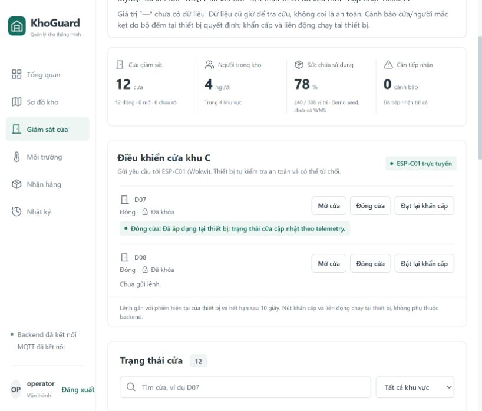

# Kiểm tra bản M06–M16 trên Windows — 13/10/2026

## Bản đã kiểm tra

- Nguồn: `docs/khoguard-iot-M06-M16.zip`, SHA-256 `A843EE78C43EA8E2539E6014AAD899377B4EFBFE9DF10623FAD365F8BCBCB647`.
- Đã nạp 133 file thay đổi/bổ sung vào checkout. Bản trước nằm trong `.local/backup-before-M06-M16-20261013`; giữ cấu hình VS Code riêng và thông tin đăng nhập hiện có.
- Giữ MySQL. Migration 003–006 được áp dụng; 001–002 kiểm checksum và giữ nguyên. Không reset lịch sử. Migration 006 tạo vị trí/sức chứa demo theo ZIP.
- CA/chứng chỉ demo và tài khoản dashboard ở `.local`, không đưa mật khẩu/khóa vào báo cáo hoặc Git. Các phép thử tạo dữ liệu mô phỏng trong schema KhoGuard.

## Kết quả thực chạy trên máy này

| Kiểm tra | Kết quả |
| --- | --- |
| `npm test` sau sửa | **102/102**, không lỗi hoặc bỏ qua |
| C++ controller, WSL g++15.2, C++17, `-Wall -Wextra -Werror` | Đạt debounce, rollover, RFID, chống đọc lặp, reconcile, revision |
| C++ safety, GNU++11, cùng cờ cảnh báo | Đạt close gate, reversal, timeout hành trình, panic latch, interlock, timer, chống trùng lệnh |
| `npm run build` | Đạt; 104 module; JS 428,13 kB, gzip 129,05 kB |
| `firmware:build` PlatformIO ESP32 | Đạt; RAM 46.852 byte (14,3%), flash 914.037 byte (69,7%) |
| `infra:mqtt:check` | 11 kiểm tra đạt |
| `infra:db:check` | 6 kiểm tra đạt |
| `infra:tls:check` sau sửa | 6 nhóm đạt, gồm CA giả, hostname sai, MQTT không mã hóa, mật khẩu sai, ACL |
| `infra:secrets:check` | 10 file được Git ignore, 11 đường HTTP trả 403 |
| `backend:check` | 9 nhóm đạt |
| `telemetry:check` | 10 nhóm đạt |
| `events:check` | 5 nhóm đạt |
| `control:check` | 7 nhóm đạt |
| `auth:check` | 5 nhóm đạt |
| `reservations:check` | 5 nhóm đạt |
| `recovery:check` | 5 nhóm đạt |
| `reports:check` | 4 nhóm đạt |
| `demo:scenarios` | 4 kịch bản, 20 bước đạt với **FakeEdge bằng Node**, không thay nghiệm thu Wokwi |
| `load:test` | 50 nguồn ảo qua 5 tài khoản; 2.000 gửi/2.000 lưu, mất 0; P95 publish→WebSocket 242 ms ở pha ổn định |
| `firmware:check` | 3 frame ESP-C01 live; schema, QoS1, seq/uptime, DHT22 hợp lệ; không truyền boot đối chiếu Serial (`boot_correlated=false`) |
| Web → backend → MQTT/TLS → Wokwi → ack → MySQL → web | D07 đang đóng: gửi **Đóng cửa**, web chuyển từ chờ sang **Đã áp dụng tại thiết bị** |
| Giao diện thực tế | 5/5 thiết bị fresh; đã mở Giám sát cửa, Nhận hàng, Nhật ký; D09 hiển thị đúng Node mô phỏng |
| Xuất CSV từ web | Tải thật `khoguard-events-2026-10-12.csv`, web xác nhận 24 dòng sự kiện, file có UTF-8 BOM |
| `git diff --check` | Đạt; có thông báo quy ước LF/CRLF |

Tải đo trên Windows AMD Ryzen 7 H 255, 16 luồng, RAM 31 GB: 25 bản tin/s trong 60 giây, sau đó burst 500. Ingest P95 pha ổn định 34 ms; burst P95 2.579 ms. Mục tiêu ≤2 giây chỉ áp dụng publish→WebSocket ở pha ổn định. Đây là mẫu marker trên WebSocket, không đo thời gian vẽ DOM. 50 nguồn ảo không phải 50 tài khoản thiết bị độc lập.

## Lỗi đã sửa

1. Test TLS nhận nhầm telemetry retained cũ trước bản tin probe. Dùng marker riêng, listener trước subscribe, đúng topic/marker, không retained, QoS1. Chạy lại với retained cũ và CA giả đều đạt.
2. Observer firmware còn ép revision=0 và toàn bộ input unknown của M03. Cập nhật theo telemetry hiện tại; vẫn kiểm schema, count chưa xác minh phải null, healthy phải có tín hiệu xác định, revision không lùi. Thêm test fail trước sửa/pass sau sửa.
3. Bảng cửa lấy nguồn môi trường của khu khiến D09 bị ghi Wokwi dù owner là SIM-C02. Ánh xạ theo owner từng cửa, thêm test hồi quy và xác nhận trên web.
4. Chú thích màn hình cửa được làm rõ theo DEC-020: hết hạn chờ phản hồi do backend đánh dấu; không khẳng định edge có đồng hồ kiểm TTL tuyệt đối. Build giao diện sau sửa đã đạt.

## Giới hạn và phần chưa nghiệm thu

- Test tự động RFID/presence/panic/reversal/timer/reconnect dùng C++ hoặc nguồn Node tùy bước. Lần này đã chứng minh telemetry và lệnh đóng D07 trên firmware Wokwi thật.
- Thao tác công tắc qua điều khiển UI chưa làm presence thay đổi. Đổi cấu hình đầu vào rồi Restart/Stop–Start cũng chưa làm mạch đang mở nhận giá trị mới. Snapshot vẫn `presence=false`, nên lệnh đóng `applied` trong những lần đó **không chứng minh lỗi close gate** và không tính là test presence đạt. Diagram đã khôi phục về bản gốc của ZIP.
- Một lệnh gửi khi Wokwi reboot chưa có ack trong cửa sổ quan sát ngắn, không tính là đạt. Lệnh đóng gửi sau khi thiết bị online/fresh đã đạt trên web.
- Còn thử đầy đủ RFID, beam/presence, panic, timer và T08 mất broker khi panic trên Wokwi. **Chưa đánh dấu M16 nghiệm thu hoàn toàn.**
- DEC-020 trong ZIP: edge không có NTP, không tự kiểm `expires_at`; backend đánh dấu hết hạn khi chưa có ack, edge kiểm boot/session/revision. Mốc 10 giây chưa phải bảo đảm TTL tuyệt đối tại edge.
- Chưa kiểm đầy đủ responsive/keyboard focus trên mọi kích thước. Console có lỗi HMR lúc đổi phiên Vite trước 08:37 UTC; không thấy lỗi mới trong phần điều hướng và xuất CSV sau đó.
- Không chạy wrapper `verify:all` trên Windows: đã chạy từng bước; C++ chạy qua WSL vì g++ không có trên Windows PATH. Không bỏ qua các bộ C++.

## Đang bật để xem

- Web `http://127.0.0.1:5173`, backend `127.0.0.1:3001`.
- MySQL 3306; broker dự án loopback 18884 và MQTT/TLS 18885; gateway Wokwi 9011.
- ESP-C01 trong VS Code; bốn nguồn Node SIM-A01/SIM-B01/SIM-C02/SIM-D01. Không chạy FakeEdge đồng thời với Wokwi.
- MySQL Workbench và MQTTX đã mở. Profile MQTTX hiện có trỏ tới broker.emqx.io, chưa đổi/kết nối profile đó; broker KhoGuard được kiểm bằng client test riêng. Tab SQL khác của người dùng trong Workbench giữ nguyên.

Log/JSON chi tiết: `.local/check-*.log`, `.local/windows-verification.json`, `.local/windows-extra-verification.json`, `.local/load-test.json`. Kết quả lỗi TLS lần đầu được giữ trong tổng hợp; kết quả chạy lại ở `.local/tls-check.json`. Bằng chứng có sẵn trong ZIP thuộc môi trường trước đó; báo cáo này ghi riêng kết quả máy Windows hiện tại.
